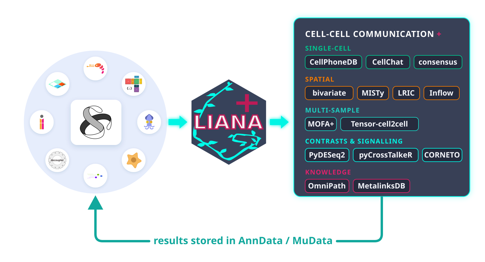
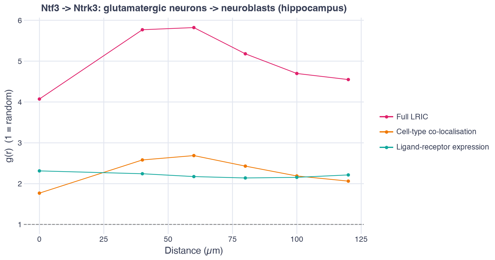
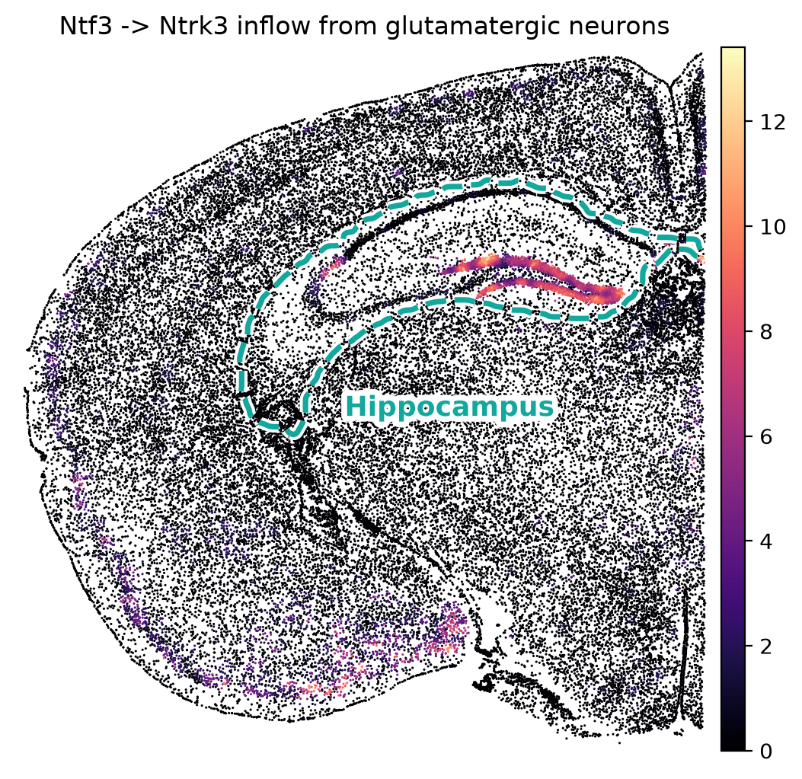

<!--
Front matter for the scverse website (scverse.org/blog); paste at the top of the post and switch image paths back to /img/blog/:
+++
title = "LIANA+ moves to scverse"
date = 2026-11-09T00:00:00+01:00
description = "LIANA+ 2.0 lives in the scverse organization and follows scverse conventions."
author = "Muskan Hashim, Daniel Dimitrov"
draft = false
+++
-->

# LIANA+ moves to scverse

*Muskan Hashim, [Daniel Dimitrov](https://github.com/dbdimitrov) · 9 November 2026*

[LIANA+](https://github.com/scverse/liana) has moved from `saezlab/liana-py` into the scverse GitHub organization where it now lives as `scverse/liana` and continues to be maintained by [Daniel Dimitrov](https://github.com/dbdimitrov).
Alongside the move, version 2.0 brings LIANA+ in line with the conventions the rest of the ecosystem follows.



## LIANA+ infers cell-cell communication from single-cell and spatial data

[LIANA+](https://doi.org/10.1038/s41556-024-01469-w) is a framework for studying cell-cell communication in single-cell and spatially resolved omics data (including multimodal data).
It works directly on [AnnData](https://anndata.scverse.org/) and [MuData](https://github.com/scverse/mudata) objects just like [scanpy](https://scanpy.scverse.org/) and [squidpy](https://squidpy.readthedocs.io/en/stable/) do.
LIANA+ combines established ligand-receptor methods with its own algorithms and consensus options, all of which work natively on multi-omics data.
For prior knowledge it draws on [OmniPath](https://omnipathdb.org/) with [MetalinksDB](https://github.com/biocypher/metalinks) adding metabolite-receptor interactions.
For comparisons across samples and conditions LIANA+ connects to [MOFA+](https://biofam.github.io/MOFA2/) and [Tensor-cell2cell](https://earmingol.github.io/cell2cell/) to find communication patterns without a predefined contrast.
When there is a specific contrast in mind, it builds on [PyDESeq2](https://github.com/scverse/pydeseq2) to prioritize differentially expressed interactions, works with [pyCrossTalkeR](https://github.com/CostaLab/pyCrossTalkeR) for network-based differential analysis and with [corneto](https://github.com/saezlab/corneto) to infer downstream signalling networks.
If you are not sure where to start, the [decision tree](https://github.com/scverse/liana#decision-tree) in the README leads from your type of data to a suitable method and its tutorial.
LIANA+ now also ships an Agent Skill for [Claude Code](https://claude.com/claude-code) that builds on this decision tree and user-inspired scenarios to pick the best method for your data and goals.

Over the past year LIANA+ has also gained two spatial methods for data at single-cell resolution.

## An Agent Skill helps Claude Code choose the right method

LIANA+ now ships with an [Agent Skill](https://docs.claude.com/en/docs/claude-code/skills) for Claude Code encoding the decision tree so that the agent picks a method that suits your data with the right defaults and knows where the results land.
This would only be needed to be installed once, after installing liana:

```shell
liana-install-skills
```

This copies the skill to `~/.claude/skills/liana/`, where Claude Code picks it up in every project.
After upgrading liana you can refresh it with `liana-install-skills --force`.
From there you can describe liana tasks in plain words, such as "compare interactions between conditions".

## LRIC and the Inflow score target single-cell resolution spatial data

LRIC and the Inflow score are both designed for spatial technologies that resolve individual cells, such as Atera, CosMx, Xenium, and MERFISH.
Both examples below use the same MERFISH section of the adult mouse brain ([Yao et al., 2023](https://doi.org/10.1038/s41586-023-06808-9)) and follow Ntf3→Ntrk3 signalling from glutamatergic neurons to neuroblasts.

**LRIC** (`li.mt.lric`) shows at which distances a ligand-receptor pair is enriched, and whether that comes from the cell types sitting together or from the ligand and receptor expression.
For example, in the hippocampus, Ntf3→Ntrk3 is enriched around 40–60 µm, driven by both cell-type co-localisation and ligand-receptor expression (see the [LRIC tutorial](https://liana.readthedocs.io/en/stable/tutorials/notebooks/LRIC_tutorial.html)).



**The Inflow score** (`li.mt.inflow`) measures how strongly each cell receives a ligand signal from a given sender cell type in its spatial neighbourhood.
Across the whole section, Ntf3→Ntrk3 inflow from glutamatergic neurons concentrates along the dentate gyrus of the hippocampus (outlined) (see the [Inflow tutorial](https://liana.readthedocs.io/en/stable/tutorials/notebooks/inflow_score.html)).



## Version 2.0 follows scverse conventions

The namespaces now more closely mirror the scanpy layout (`li.pp`, `li.mt`, `li.pl`, `li.ms`, `li.ds` and `li.rs`).
`use_raw` now defaults to `False` as it does in squidpy and [decoupler](https://decoupler.readthedocs.io/en/latest/) so methods read from `adata.X` unless you tell them otherwise.
Under the hood, the codebase is synced with the [scverse package template](https://github.com/scverse/cookiecutter-scverse) and type-checked with [mypy](https://github.com/python/mypy) in CI.
The release also includes an audit of the codebase with several fixes that affect results so numbers may shift slightly when you upgrade (this is intended).

## Existing code needs new import paths and defaults

If you already use LIANA+, most of what changes for you comes down to import paths and a few defaults:

| 1.x | 2.0 |
|---|---|
| `li.ut.spatial_neighbors` and other preprocessing helpers | `li.pp` |
| `li.ut.get_factor_scores` and related helpers | `li.ms` |
| `li.mu` | renamed to `li.ms` (multisample) |
| `li.testing` | renamed to `li.ds` (datasets) |
| `use_raw=True` by default | `use_raw=False`; pass `use_raw=True` to keep reading `.raw` |
| spatial weighting whenever `obsm["spatial"]` exists | opt-in via `spatial_key` |
| `expr_prop=0.1` in single-cell methods and `rank_aggregate` | `expr_prop=0.05` |

## Get started

LIANA+ is available on PyPI:

```shell
pip install liana
```

The [documentation](https://liana.readthedocs.io/en/latest/) has tutorials for each method and issues or contributions are welcome on [GitHub](https://github.com/scverse/liana).
If you are new to scverse, [scverse.org/join](https://scverse.org/join/) is a good place to start.

<br>

*the scverse team.*
